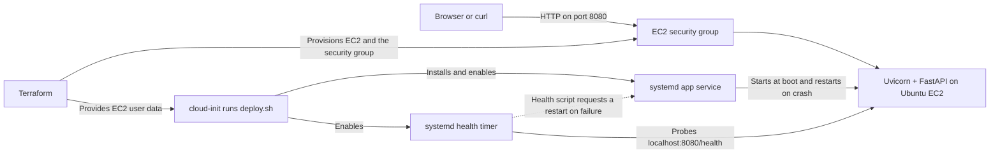

# Junior Platform Engineer Assignment

A FastAPI service on one Ubuntu EC2 instance. `GET /` returns a short greeting and `GET /health` returns plain-text `OK` with HTTP `200`.

## Architecture



Terraform creates the instance in an existing public subnet. The security group allows public TCP `8080`. If enabled, SSH accepts connections from a single IPv4 address. EC2 user data contains the project files needed for first boot. The [deployment script](scripts/deploy.sh) runs Uvicorn as an unprivileged user. The health timer checks the app about once a minute.

## Run locally

You need Python 3.10 or newer. Run these commands from the repository root in PowerShell.

```powershell
python -m venv .venv
.\.venv\Scripts\python.exe -m pip install -r requirements-dev.txt
.\.venv\Scripts\python.exe -m pytest -v tests
.\.venv\Scripts\python.exe -m uvicorn app.server:app --host 127.0.0.1 --port 8080
```

From a second terminal, check both routes.

```powershell
curl.exe --fail -i http://127.0.0.1:8080/
curl.exe --fail -i http://127.0.0.1:8080/health
```

## Deploy to AWS

You need Terraform, an authenticated AWS CLI session with permissions to read subnet and Ubuntu AMI details and manage the EC2 resources in this configuration, and an existing public subnet with an IPv4 route to an internet gateway. Terraform `1.14.7` was used for validation. A subnet in the default VPC is one option if its public routing is intact. [AWS default VPC documentation](https://docs.aws.amazon.com/vpc/latest/userguide/default-vpc.html)

Before provisioning, check that your account's free usage or credits cover the Ubuntu `t3.micro`, its EBS root volume, and the public IPv4 address. Use the Ubuntu VM fallback below if you cannot confirm coverage. [EC2 Free Tier guidance](https://docs.aws.amazon.com/AWSEC2/latest/UserGuide/ec2-free-tier-usage.html) · [Public IPv4 pricing](https://aws.amazon.com/vpc/pricing/)

Create `terraform/terraform.tfvars` with your values. For SSH-based verification, use your current public IPv4 address with `/32` and the name of a key pair in the selected region. Omit `ssh_access` to leave SSH closed.

```hcl
aws_region = "us-east-1"
subnet_id  = "subnet-0123456789abcdef0"

ssh_access = {
  cidr     = "203.0.113.25/32"
  key_name = "your-existing-ec2-key"
}
```

Run the following from the repository root. Review the plan before applying it.

```powershell
aws sts get-caller-identity
terraform -chdir=terraform init -lockfile=readonly
terraform -chdir=terraform plan -out=tfplan
terraform -chdir=terraform apply tfplan
$appUrl = terraform -chdir=terraform output -raw app_url
$instanceIp = ([uri]$appUrl).Host
terraform -chdir=terraform output -raw instance_id
```

Allow a few minutes for first-boot setup. If SSH is enabled, connect and use `sudo cloud-init status --wait` to check completion.

```powershell
ssh -i "C:\path\to\your-key.pem" "ubuntu@$instanceIp"
```

On your laptop, check the public request path through the security group.

```powershell
curl.exe --fail -i "$appUrl/"
curl.exe --fail -i "$appUrl/health"
```

## Verify startup and recovery

Run each test separately so the logs show which component recovered the service. Use the EC2 shell or the console of the local Ubuntu VM.

| Test | Action | Expected result |
|---|---|---|
| Boot configuration | Run `systemctl is-enabled platform-app.service platform-health.timer`. Then reboot with `sudo reboot`. | Both units are enabled and `/health` responds after reboot. |
| Process crash | Run `sudo systemctl kill --signal=SIGKILL platform-app.service`. Check the app journal and retry `/health` after a few seconds. | The app journal records a restart and the endpoint responds again. |
| Failed HTTP probe | Run `sudo systemctl stop platform-app.service` while the timer is active. Use `systemctl list-timers platform-health.timer` to see when the next probe runs. | The health journal records the failed probe and a restart request. `/health` responds again. |

```bash
sudo journalctl -u platform-app.service -n 25 --no-pager
sudo journalctl -u platform-health.service -n 25 --no-pager
```

**Verified on EC2 on November 20, 2026.** The [GitHub Actions deployment](https://github.com/Kodariganesh/platform-engineering-assignment/actions/runs/44679407650) passed its public health check. AWS CloudTrail recorded a stop at 10:48:13 IST and a start at 10:58:56 IST. A public request to the restarted instance returned `HTTP/1.1 200 OK` at 11:47:29 IST.

- **Reboot.** The Linux boot ID changed after an EC2 reboot. The public `/health` endpoint returned HTTP `200` and `OK` after boot.
- **Process crash.** After sending `SIGKILL` to Uvicorn, systemd logged `Main process exited, code=killed, status=9/KILL` and `Scheduled restart job, restart counter is at 1.` The process ID changed and the public health check passed.
- **Failed HTTP probe.** After stopping the app service, the timer logged `Health check failed for http://127.0.0.1:8080/health (HTTP 000). Restarting platform-app.service.` The public health check passed after the timer restarted the app.

The live tests used EC2 Instance Connect with a temporary SSH rule limited to one IPv4 address. The rule was removed after the tests.

## Ubuntu VM fallback

Use a disposable Ubuntu 24.04 VM with systemd, sudo, and internet access for package installation. Copy the repository into the VM and run these commands from its root.

```bash
sudo bash scripts/deploy.sh
curl --fail -i http://127.0.0.1:8080/
curl --fail -i http://127.0.0.1:8080/health
```

Run the same reboot and recovery tests in the VM. On AWS, Terraform supplies the public IP and security group, and cloud-init calls the same deployment script on first boot. An external client on AWS uses the public URL on port `8080`.

## CI and validation evidence

The [GitHub Actions workflow](.github/workflows/ci.yml) runs pytest, starts Uvicorn and probes `/health`, checks Bash syntax, and runs Terraform formatting and configuration checks. AWS deployment is run separately.

Local validation completed for the route tests, Bash syntax, and Terraform formatting and configuration. Example output from the local app tests and Terraform validation is shown below.

```text
3 passed
Success! The configuration is valid.
```

The hosted [GitHub Actions validation run](https://github.com/Kodariganesh/platform-engineering-assignment/actions/runs/44676559249) passed.

## Outage checks

1. Call the public `/health` URL. If it fails, check the instance state and current IP in EC2, then call `http://127.0.0.1:8080/health` from the instance.
2. If the local request succeeds, check the security group, public subnet route, and Uvicorn's listen address with `sudo ss -ltnp`. The app should listen on `0.0.0.0:8080`.
3. If the local request also fails, run `sudo systemctl status platform-app.service` and inspect its journal. Check the health timer and `platform-health.service` journal to see whether a restart was attempted.
4. If the service never started on a newly launched instance, run `sudo cloud-init status --long` and inspect `/var/log/cloud-init-output.log` for the first failing deployment command.

## Cleanup and limitations

For a **laptop deployment**, use the original Terraform directory and its local state. Run `terraform -chdir=terraform destroy` and review the proposed deletions before confirming.

For a **GitHub Actions deployment**, use the S3 backend that owns the deployment. From PowerShell, use a fresh clone and an AWS CLI profile with access to the state bucket and EC2 resources. Replace the two placeholders with the matching GitHub `production` environment variables.

```powershell
$env:AWS_PROFILE = "platform-assignment"
$env:TF_VAR_aws_region = "ap-southeast-2"
$env:TF_VAR_subnet_id = "<TF_SUBNET_ID>"
$bucket = "<TF_STATE_BUCKET>"
$cleanupDir = Join-Path $env:TEMP ("platform-cleanup-" + [guid]::NewGuid().ToString("N"))
git clone https://github.com/Kodariganesh/platform-engineering-assignment.git $cleanupDir
Set-Location -LiteralPath $cleanupDir
@"
terraform {
  backend "s3" {}
}
"@ | Set-Content -LiteralPath terraform/github-backend.tf -Encoding ascii
$backend = @(
  "-backend-config=bucket=$bucket"
  "-backend-config=key=platform-assignment/production.tfstate"
  "-backend-config=region=$env:TF_VAR_aws_region"
  "-backend-config=encrypt=true"
  "-backend-config=use_lockfile=true"
)
terraform -chdir=terraform init -input=false -lockfile=readonly @backend
terraform '-chdir=terraform' plan -destroy '-out=cleanup.tfplan'
```

Review the saved plan. When it lists only the intended deployment resources for deletion, run `terraform '-chdir=terraform' apply 'cleanup.tfplan'`. The S3 bucket was created separately and holds the state for future deployments. For the local fallback, remove the disposable Ubuntu VM after saving the evidence.

The demo uses plain HTTP and one EC2 instance. A reboot causes a brief outage. Terraform replaces the instance when its embedded first-boot files change, so an update can cause downtime and change the public URL.
